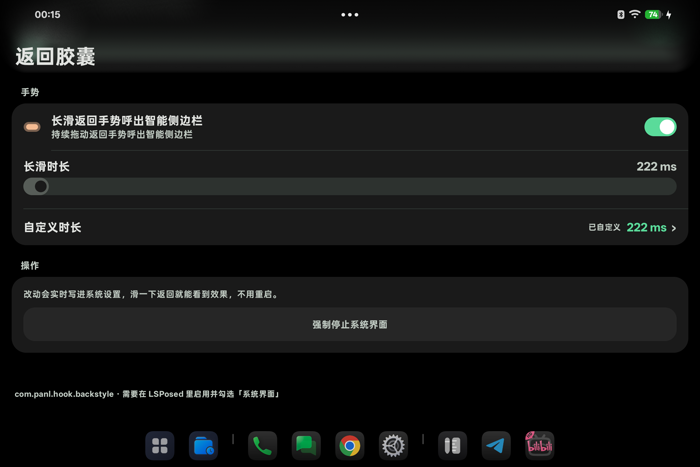
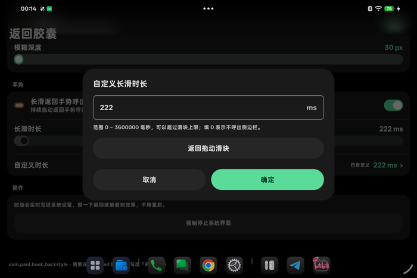

# 返回样式 · BackStyleMod（fork）

> **这是 fork，不是原项目。** 原作者是 **[sakurakingfifth-debug](https://github.com/sakurakingfifth-debug)**，
> 项目 [sakurakingfifth-debug/BackStyleMod](https://github.com/sakurakingfifth-debug/BackStyleMod)，MIT 许可。
>
> 本 fork 由 [ByteJuno](https://github.com/ByteJuno) 维护，**没有改动 `app/` 下的上游源码**，
> 只额外做了几个补丁。完整说明见 [NOTICE.md](NOTICE.md)。

**下载**：<https://github.com/ByteJuno/BackStyleMod/releases>

- 手机 → `backstyle-7.0-phone.apk`
- 平板 → `backstyle-7.0-tablet.apk`

两包同签名（`CN=BackStyleMod`），与上游官方包（`CN=panl`）**不是同一把钥匙**，不能互相覆盖安装。

---

## 本 fork 改了什么

| 功能 | 设置项（`Settings.Global`） | 默认 | 说明 |
|---|---|---|---|
| **桌面也能用返回手势** | `backstyle_desk_back` | 开 | ColorOS 在桌面获得焦点时会由 SystemUI 注册一块几乎全屏的手势排除区（实测 `SkRegion((0,141,1272,2772))`），把边缘手势吃掉。本 fork 清空它，并清掉 `LayoutParams.backGestureRestriction` 的 bit0 |
| **隐藏智能侧边栏浮标** | `backstyle_floatbar_hide` | 开 | 浮标收起后原本要停留 3 秒（`FloatBarMainView.scheduleAutoHideDelay()` 里硬编码 `3000`），改成永不显示 |
| 平板适配 | — | — | 原生返回 / 长滑侧栏桥接 |
| 长滑时长下限 0 ms | `backstyle_pill_sidebar_ms` | — | **上游 6.2/6.3 起已自行实现**（0~15000 ms + 手填），此处仅保留早期补丁线上的同类改动 |

补丁以 apktool 反编译工程的形式放在 [`smali-patch/`](smali-patch/)，起步时上游还没开源，
所以是 smali 而不是源码；长期应该改写成源码级补丁。

想关掉某个功能：

```bash
adb shell settings put global backstyle_desk_back 0
adb shell settings put global backstyle_floatbar_hide 0
```

## ⚠️ LSPosed 作用域要勾三个

本 fork 的 hook 分布在三个进程，**三个都要勾**，漏勾不会报错、只是静默不生效：

| 进程 | 包名 | 作用 |
|---|---|---|
| 系统界面 | `com.android.systemui` | 胶囊绘制、长滑呼出侧栏 |
| 桌面 | `com.android.launcher` | 桌面返回手势 |
| 智能侧边栏 | `com.coloros.smartsidebar` | 隐藏浮标 |

## 安装

1. 装 APK，LSPosed 里启用模块，作用域勾上表三个
2. `killall com.android.systemui`，**再重启一次手机**（重装模块后 launcher 常常不再被注入）
3. 打开 App 调参数

> 浮标不想勾作用域也能先凑合：`adb shell settings put secure edge_panel_os_float_bar_alpha 0`
> （合法区间 0~80，默认 40）。缺点是只做到透明，浮标的触摸区还在。恢复：设回 `40`。

## 还原成上游行为

```bash
adb uninstall com.panl.hook.backstyle      # 换签名必须卸载
# 然后装上游官方包：https://github.com/sakurakingfifth-debug/BackStyleMod/releases
```

设置项在卸载后会丢失，重新调一遍即可。

---

以下为**上游 README 原文**，未作修改。

---

我懒，所以README.md是大肥鱼写的

一个 LSPosed 模块：把侧滑返回那个箭头背后的「水滴」换成**竖向胶囊**，可以调尺寸、透明度、背景模糊，长按还能呼出智能侧边栏。

An LSPosed module that replaces the gesture-back "teardrop" behind the arrow with a **vertical capsule** (shape, size, opacity, blurred backdrop, long-press → smart sidebar).

<p align="center">
  
  
</p>

## 功能

- **胶囊尺寸** —— 上下高度 150%~700%、左右宽度 30%~120%，实时生效
- **不透明度** —— 0%~100%
- **背景模糊** —— 30~80px 真实高斯模糊，走系统截屏 + 可分离方框卷积；暗色模式自动加 2dp 描边
- **长滑呼出智能侧边栏** —— 侧滑按住超过设定时长（0~15000ms 滑块，或手填到 3600000ms）后呼出 ColorOS 智能侧边栏，自动跟随左右侧
- **深色/浅色自适应** —— 按背景亮度自动反色图标
- **PUI 风格设置页**，简中 / 繁中 / 英 / 日 / 韩 五种语言

## 支持范围

| 项目 | 要求 |
|---|---|
| 系统 | ColorOS / OPPO / OnePlus（`com.oplus.systemui` 的 `SideGestureNavView`），Android 14+ |
| AOSP 机型 | 有 `com.android.systemui.navigationbar.gestural.BackPanel` 的走备用方案（只改椭圆尺寸） |
| 框架 | LSPosed，作用域勾选「系统界面 (com.android.systemui)」 |
| 权限 | root（设置项通过 `su -c settings put global` 写入） |

已在 OnePlus / OPPO 的 ColorOS 15~17 上验证；其它 ROM 只要类名没改大概率也能用，改了就改常量：

```
MainHook.OPLUS_VIEW    com.oplus.systemui.navigationbar.gesture.sidegesture.view.SideGestureNavView
MainHook.OPLUS_CALC    com.oplus.systemui.navigationbar.gesture.sidegesture.view.animcalculator.BaseBezierCalculator
```

## 构建

```bash
export JAVA_HOME=/path/to/jbr      # 需要 JDK 17+，实测 JDK 25
./gradlew assembleRelease
# 产物：app/build/outputs/apk/release/app-release.apk
```

工具链：AGP 9.2.1 / Gradle 9.6 / compileSdk 37 / minSdk 34。
仓库里带了 `app/libs/api-82.jar`（Xposed API）和 `pui-release.aar`（设置页用的设计系统），所以离线也能编。

## 安装

1. 装 APK，在 LSPosed 里启用模块并勾选「系统界面」
2. 重启系统界面（设置页底部有「强制停止系统界面」按钮，或 `killall com.android.systemui`）
3. 打开 App 调参数，滑一下返回即可看到效果

> 注意：**装完新版本必须重启一次系统界面**，LSPosed 只在进程启动时加载模块。App 检测到版本变化会提示。

## 设置项（`Settings.Global`）

| key | 含义 | 默认 |
|---|---|---|
| `backstyle_pill_height` | 胶囊高度倍率（×箭头边长） | `3.6` |
| `backstyle_pill_width` | 胶囊宽高比 | `0.68` |
| `backstyle_pill_alpha` | 不透明度百分比 | `100` |
| `backstyle_pill_blur_on` | 背景模糊开关 | `1` |
| `backstyle_pill_blur` | 模糊半径 px（30~80） | `30` |
| `backstyle_pill_sidebar` | 长滑呼出侧边栏开关 | `1` |
| `backstyle_pill_sidebar_ms` | 长滑时长 ms（0 = 不呼出） | `5000` |
| `backstyle_pill_sidebar_custom` | 是否使用手填时长（滑块置灰） | `0` |

改完不用重启，hook 端每秒读一次。

## 实现要点

- **不再 hook `BaseBezierCalculator.getPath()`** —— 新版系统界面把它改成了三行指令的 `public final` getter，会被 ART 内联进 `onDraw`，hook 收不到回调（6.0 就是这么静默失效的）。现在在 `SideGestureNavView.onDraw` 里反射拿同一个 `Path` 对象、`computeBounds` 记宽度、`reset()`，帧帧都走这条路。
- **模糊**：`IWindowManager.captureDisplay(int, CaptureArgs, ScreenCaptureListener)`（3 参数）+ HokoBlur 式可分离方框卷积，截完图把胶囊自身那块抹掉避免鬼影；预测性返回期间改用透传。
- **位置**：直接取箭头的 `backIconMatrix`，手势位移/缩放/左右方向全跟着系统走，不自己算坐标。
- **禁止**在 `MainHook` 的静态字段里碰 Handler / Looper / Context —— 模块类加载时 SystemUI 主线程还没准备好，会在类初始化阶段直接炸掉整个模块。

## 更新日志

### 6.5
- 对话框改用色块按钮（取消 / 确定 / 返回拖动滑块）

### 6.4
- 修复长滑时长改不动：写入同时兼容旧的「秒」键；模块版本变化时提示重启系统界面；hook 打印实际读到的时长

### 6.3 / 6.2
- 长滑时长单位改成毫秒，滑块 0~15000ms，新增手填（上限 3600000ms），手填后滑块置灰

### 6.1
- 修复在系统界面 17.99.02 上完全不生效（`getPath` 被内联）

### 6.0
- 五语言、自适应图标、暗色描边、强制停止系统界面

### 3.x ~ 5.x
- 胶囊几何、出现/消失动画、截屏模糊、长滑侧边栏、自动反色

## 本 fork 的更新日志

### 7.0
- 新增「桌面也能用返回手势」（`backstyle_desk_back`）
- 新增「隐藏智能侧边栏浮标」（`backstyle_floatbar_hide`）
- 平板版合并 `tablet-adaptation` 的 GestureUI 线程修复与原生侧栏桥接
- 手机 / 平板统一版本号，versionCode 70 / 71

## License

MIT，见 [LICENSE](LICENSE)（版权归 sakurakingfifth-debug，本 fork 未修改该文件）。
